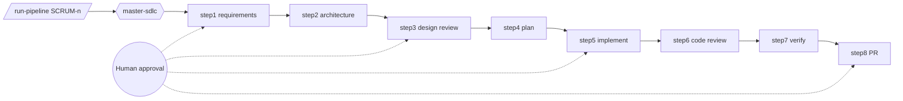

# claude-doc-sync

A zero-dependency Node.js CLI that fills in `{{Placeholder}}` tokens in a
Markdown template using only values it can verify from a real repository.
Anything it can't verify is rendered as the literal text `Not Found` — it
never guesses.

## Usage

```sh
node bin/claude-doc-sync.js --template <template.md> [--repo <repo-path>] [--out <output.md>]
```

- `--template <path>` (required) — the Markdown template to fill.
- `--repo <path>` (optional, default: current directory) — the repository to
  verify placeholder values against.
- `--out <path>` (optional, default: `<template-basename>.filled.md` in the
  current directory) — where to write the filled document. The template
  itself is never modified.

On success it prints a one-line summary, e.g. `8 / 10 placeholders found.`,
and exits `0`. On a fatal error (missing template, bad `--repo` path) it
prints `Error: ...` to stderr and exits `1`.

## Supported Placeholders

| Placeholder | Verified from |
|---|---|
| `{{ProjectName}}` | `package.json` → `name` |
| `{{Description}}` | `package.json` → `description` |
| `{{MainEntryPoint}}` | `package.json` → `main` (fallback: `bin`) |
| `{{Dependencies}}` | `package.json` → `dependencies` |
| `{{DevDependencies}}` | `package.json` → `devDependencies` |
| `{{TestCommand}}` | `package.json` → `scripts.test` |
| `{{Author}}` | `package.json` → `author` |
| `{{License}}` | `package.json` → `license` |
| `{{LastCommitDate}}` | `git log -1 --format=%cI` |
| `{{LastCommitAuthor}}` | `git log -1 --format=%an` |

Any other `{{Token}}` in the template is left as `Not Found` — it's not an
error, just unverifiable.

Notes on behaviour:

- Only exact `{{Name}}` tokens (letters, digits and underscore, no spaces)
  are recognised. `{{ Name }}` is left unchanged in the output and is not
  counted.
- In `N / M placeholders found`, `M` is the number of distinct token names.
  A name that appears several times counts once and is replaced everywhere.
- A UTF-8 byte order mark at the start of `package.json` is ignored.
- If any version in `dependencies` or `devDependencies` is not a string, the
  whole field is `Not Found`.
- `--repo` inside a larger git repository reports the last commit of the
  enclosing repository.
- Known limitation: the check that stops `--out` from overwriting the
  template compares real paths, so it catches symlinks and different
  spellings but does not detect a hard link to the template.
- Known limitation: `dependencies` (or `devDependencies`) written as an
  array instead of an object, for example `["a"]`, is not rejected and
  renders as `0@a`. A valid `package.json` uses an object, so this only
  affects malformed files.

## Example

Given `templates/project-doc.template.md` and running against this repo
itself:

```sh
node bin/claude-doc-sync.js --template templates/project-doc.template.md --repo . --out out.md
```

produces a filled `out.md` with real values pulled from this project's own
`package.json` and git history, and `Not Found` for anything not verifiable
(e.g. `Dependencies`, since this project has none).

## Design

See [`requirements.md`](generatedDocs/requirements.md),
[`architecture.md`](generatedDocs/architecture.md),
[`design-review.md`](generatedDocs/design-review.md), and
[`impl-plan.md`](generatedDocs/impl-plan.md)
for the full requirements-through-implementation trail.

## Development

Requires Node.js ≥ 20 (uses the built-in `node:test` runner).

```sh
npm test
```

The tool has no runtime `dependencies`; the runtime code and the unit,
integration and CLI tests rely solely on Node.js built-in modules. The only
`devDependency` is `@playwright/test`, used by `npm run test:e2e`.

## Agentic SDLC pipeline (Claude Code)

<!-- agentic-pipeline -->


| Layer | Where | Purpose |
|---|---|---|
| Command | `.claude/commands/run-pipeline.md` | One-command start |
| Agents | `.claude/agents/` | master + 8 step agents |
| Skills | `.claude/skills/` | `placeholder-verifier`, `git-metadata-reader` |
| Rules / instructions | `.claude/rules/`, `.claude/instructions/` | Not Found, human-in-the-loop, security, conventions |
| Hooks | `.claude/settings.json` | Before: commit secret guard · After: doc-drift check · Stop: doc-drift |
| MCP | `.mcp.json` | Atlassian and GitHub |
| Config | `.claude/config/app-profile.yml` | Single source of app facts |

Traceability: `generatedDocs/trace-log.md` · Handoff: `generatedDocs/handoff.md`

## Build and deploy
```bash
npm run build         # runs the tests, then creates dist/claude-doc-sync-<version>.tgz and dist/BUILD-INFO.json
npm run deploy:local  # installs the artifact into .deploy/ and smoke-tests the installed CLI
npm run release       # build + deploy:local
```
Gherkin test cases: `features/placeholder-sync.feature`; traceability to automated tests: `generatedDocs/test-cases.md`.
